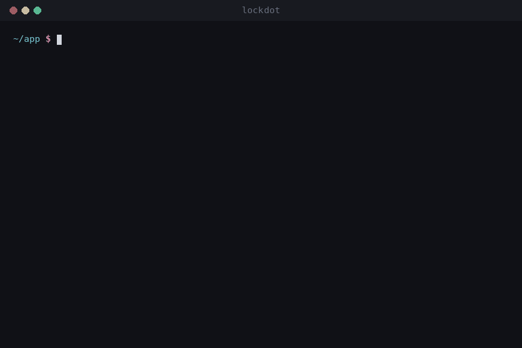
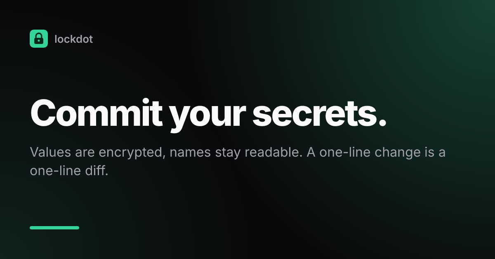
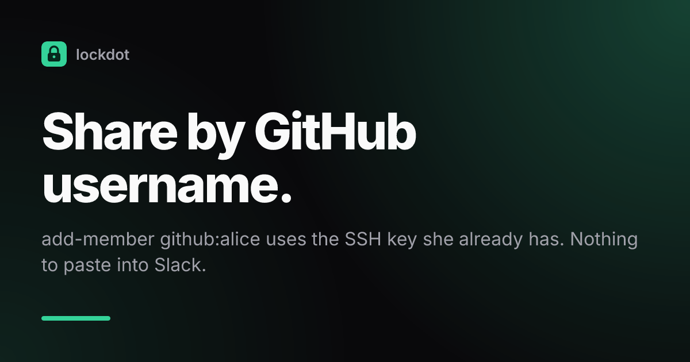
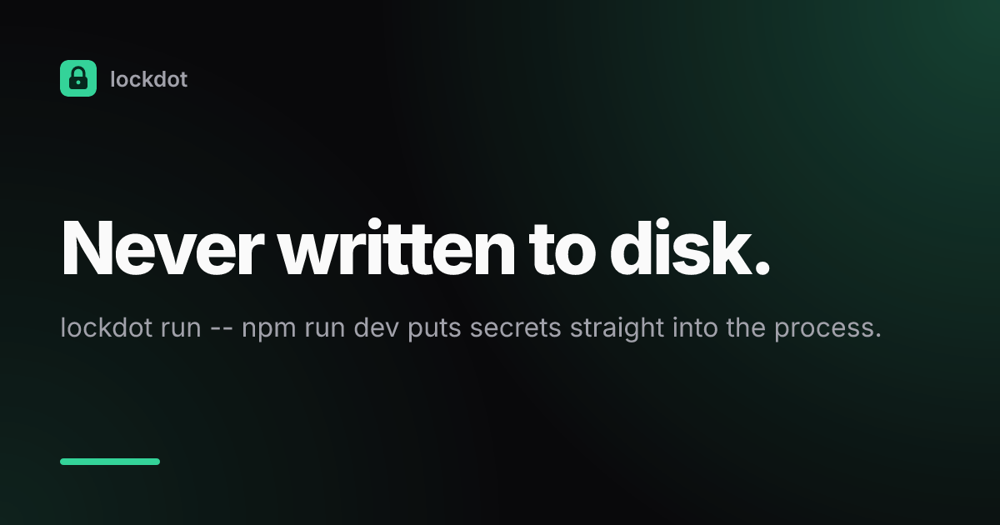
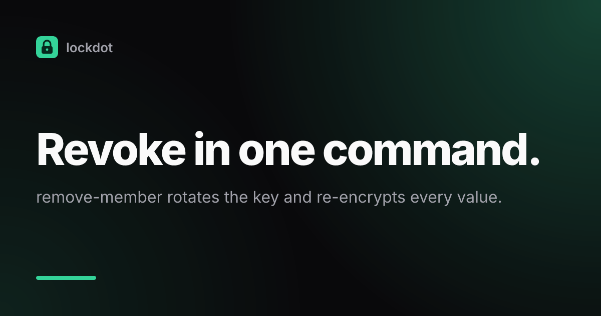

<h1 align="center">lockdot</h1>

<p align="center">
  Encrypted <code>.env</code> files you can commit to git and share with your team.
</p>

<p align="center">
  <a href="https://github.com/whosdrix/lockdot/actions/workflows/ci.yml"></a>
  <a href="https://crates.io/crates/lockdot"></a>
  <a href="LICENSE"></a>
</p>

<p align="center">
  
</p>

Your secrets live in the repo next to the code, encrypted. Variable names stay readable, so pull requests and `git diff` still make sense. Teammates get access with their GitHub username, and nobody pastes keys into Slack again.

```sh
lockdot init --from .env            # encrypt the .env you already have
lockdot add-member github:alice     # alice can now decrypt it with her SSH key
lockdot run -- npm run dev          # secrets go into the process, never onto disk
```

## Install

```sh
brew install whosdrix/tap/lockdot
```

```sh
cargo install lockdot
```

```sh
curl -LsSf https://github.com/whosdrix/lockdot/releases/latest/download/lockdot-installer.sh | sh
```

Or grab a prebuilt binary for macOS, Linux or Windows from [Releases](https://github.com/whosdrix/lockdot/releases).

## Why

<p align="center">
  
  
  
  
</p>

| | lockdot | `.env` in Slack | sops | git-crypt |
|---|:-:|:-:|:-:|:-:|
| Lives in git, versioned with the code | ✓ | | ✓ | ✓ |
| Readable diffs (names visible, only changed values change) | ✓ | | ✓ | |
| Share by GitHub username | ✓ | | | |
| Works with the SSH key you already have | ✓ | | ✓ | |
| No config file or GPG setup | ✓ | ✓ | | |

## How it works

```
# This file is encrypted with lockdot. Names are readable, values are not.
#@lockdot v1
#@member drix age1x97fwlje6gyxefl0fcj209ctss2cm8e8gtnff5dx37mqw66fzq6qqkrxmw
#@member github:alice ssh-ed25519 AAAAC3NzaC1lZDI1NTE5AAAAIPsrcef...
#@datakey YWdlLWVuY3J5cHRpb24ub3JnL3YxCi0+IFgyNTUxOSA4MG9xb0kx...
#@mac 2fjaTM0QDdxdTqd6LipHM5mFmjWGXQKyUGMWgBZLTbM=

DATABASE_URL=lockdot:v1:XjvxFlv4seidmYMMwisl9m7wKpS760nPXuVjUNNUex5W9tAe...
STRIPE_KEY=lockdot:v1:Q6VCqnkv4cEl0h5dcNQ4DDIZgCsBNkDQ5XmbGhgyhUNfBUJu1t6X...
```

- Each file has one random data key. It is encrypted with [age](https://age-encryption.org) once per member, so adding a person never touches the values.
- Each value is encrypted on its own with XChaCha20-Poly1305. The variable name is bound to its value, so a value can't be moved to a different name.
- A MAC over the members and all values catches lines that were added, removed or swapped by hand.
- Values are padded to 32 bytes, so the file doesn't reveal exact secret lengths.
- When a value doesn't change, its ciphertext doesn't either. A one-line change is a one-line diff.

The full threat model is in [SECURITY.md](SECURITY.md).

## Usage

### Keys

`lockdot init` creates your key at `~/.config/lockdot/identity.txt` if you don't have one. lockdot also uses `~/.ssh/id_ed25519` and `~/.ssh/id_rsa`, so a teammate added with `github:username` needs no setup at all.

```sh
lockdot whoami        # the public key to send a teammate (your SSH key if you have one)
lockdot whoami --age  # create and print a separate lockdot key instead
```

### Secrets

```sh
lockdot set STRIPE_KEY sk_live_...
lockdot set TLS_CERT < cert.pem       # value from stdin
lockdot get STRIPE_KEY
lockdot ls                            # names only, no key needed
lockdot unset OLD_TOKEN
lockdot edit                          # opens the decrypted file in $EDITOR
lockdot import .env.local             # merge a plaintext file in
lockdot export --format json          # dotenv, json or shell
```

`lockdot edit` writes the plaintext to a private temp file, opens your editor, and re-encrypts on save. Comments and blank lines are kept.

### Run

```sh
lockdot run -- npm run dev
lockdot run -e prod -- ./deploy.sh
```

Variables already set in your shell win, like with dotenv. Pass `--override` to let the file win instead.

### Environments

`-e NAME` switches to `.env.NAME.lockdot`. You can also set `LOCKDOT_ENV`.

```sh
lockdot -e staging init
lockdot -e staging set API_URL https://staging.example.com
```

Each environment has its own members, so you can give the whole team `dev` and only a few people `prod`.

### Team

```sh
lockdot add-member github:alice               # all of alice's ed25519/RSA keys on GitHub
lockdot add-member age1ql3z7hjy54pw3hyww5...  # an age key from `lockdot whoami`
lockdot add-member "ssh-ed25519 AAAA..." --name bob
lockdot members
lockdot remove-member github:alice
```

`remove-member` generates a new data key and re-encrypts every value, so the removed person can't read anything you set from then on. They could still have the old values from git history, so rotate the real secrets as well.

### CI

Create a separate key for CI and add it as a member:

```sh
LOCKDOT_IDENTITY_FILE=ci-key.txt lockdot whoami --age   # prints the public key
lockdot -e prod add-member age1... --name ci
```

Copy the `AGE-SECRET-KEY-...` line from `ci-key.txt` into your CI secrets as `LOCKDOT_KEY`, then delete the file.

```yaml
- run: curl -LsSf https://github.com/whosdrix/lockdot/releases/latest/download/lockdot-installer.sh | sh
- run: lockdot run -e prod -- npm run build
  env:
    LOCKDOT_KEY: ${{ secrets.LOCKDOT_KEY }}
```

`lockdot check` needs no key. It fails when a variable from `.env.example` is missing, which catches "works on my machine" before deploy:

```sh
lockdot check                 # uses .env.example if present
lockdot check --decrypt       # also decrypts everything and verifies the MAC
```

### Readable git diffs

Tell git to show decrypted values in `git diff` and `git log -p` on your machine:

```sh
git config diff.lockdot.textconv "lockdot textconv"
echo '*.lockdot diff=lockdot' >> .gitattributes
```

People without access see the encrypted text, as before.

## Environment variables

| Variable | |
|---|---|
| `LOCKDOT_KEY` | One or more `AGE-SECRET-KEY-...` lines. Used before any key file. |
| `LOCKDOT_IDENTITY_FILE` | Use a different identity file. |
| `LOCKDOT_ENV` | Default for `-e`. |
| `LOCKDOT_NO_SSH` | Don't try `~/.ssh` keys. |
| `NO_COLOR` | Plain output. |

## License

[MIT](LICENSE)
